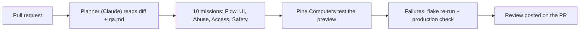

# PinePoint

**QA agents for every pull request.** PinePoint sends 10 simulated users through your Vercel preview, each on its own Pine Computer with a real browser, and posts what broke as a review on the PR.

    

**Live:** [pinepoint-rho.vercel.app](https://pinepoint-rho.vercel.app) (app at [`/app`](https://pinepoint-rho.vercel.app/app)) · Demo store: [pinepoint-demo-store.vercel.app](https://pinepoint-demo-store.vercel.app)

## How a run works



Watch it live in `/app`: mission cards by lens, the live desktop (take control, full screen), screenshots of each step, and the real cost.

## Cost

Pine reports tokens and cost for each mission. On 60 real missions, Pine charged about **$0.012 per mission** and **$0.14 to $0.16 per run**. The run page compares the same tokens at six model list prices, cache rates included.

## Demo PRs

Draft PRs with a planted bug. Never merge them.

| PR | Bug | Expected | Preview shows |
| --- | --- | --- | --- |
| [#10](https://github.com/vihuynh72/pinepoint/pull/10) | Coupon applies two times | $21.60 | $19.44 |
| [#29](https://github.com/vihuynh72/pinepoint/pull/29) | Remove one goes below zero | Empty cart | $-20.00 |
| [#31](https://github.com/vihuynh72/pinepoint/pull/31) | Express shipping turns free | $36.00 | $24.00 |
| [#33](https://github.com/vihuynh72/pinepoint/pull/33) | Two coupons stack | $44.10 | $37.49 |
| [#34](https://github.com/vihuynh72/pinepoint/pull/34) | Saved cart doubles on reload | $24.00 | $48.00 |
| [#11](https://github.com/vihuynh72/pinepoint/pull/11) | None (clean control) | | |

The list is in [`eval/planted.json`](eval/planted.json).

## Quick start

Node.js 22 and pnpm 10.

```sh
pnpm install
pnpm -r build     # build everything
pnpm dev          # apps/web on http://localhost:3000
pnpm dev:store    # apps/demo-store on http://localhost:3001
```

Copy `.env.example` to `apps/web/.env.local` and fill it in. Never commit a value: the repo is public. `GET /api/health` shows which variables a deployment has, as `true` or `false`.

## Layout

| Path | What |
| --- | --- |
| `apps/web` | Next.js app: landing at `/`, app at `/app`, API under `app/api` |
| `apps/demo-store` | The demo store that the planted PRs change |
| `packages/core` | Types, zod schemas, database, encryption |
| `packages/runner` | Pine Computer wrapper and run orchestration |
| `packages/github` | PR context, review posting, webhook checks |
| `packages/ai` | Planner and other Claude calls |
| `db/` | Postgres schema (Neon) |

## Database and tests

```sh
pnpm --filter @pinepoint/core db:migrate   # apply db/*.sql; safe to run twice
pnpm --filter core test
pnpm --filter ai test
pnpm --filter @pinepoint/runner test
pnpm --filter @pinepoint/github test
```

## GitHub webhook

When a demo store preview deploys for an open PR that changes `apps/demo-store/`, PinePoint starts a run by itself, drives it with nobody on `/app`, and posts the review.

1. Make a secret: `openssl rand -hex 32`.
2. Vercel project `pinepoint`: add `GITHUB_WEBHOOK_SECRET`, check `APP_BASE_URL` is `https://pinepoint-rho.vercel.app`, then redeploy.
3. GitHub repo Settings, Webhooks: payload URL `https://pinepoint-rho.vercel.app/api/github/webhook`, content type `application/json`, the same secret, events "Pull requests" and "Deployment statuses".
4. The ping in Recent Deliveries shows 200.

Optional: `PINEPOINT_WEBHOOK_PATHS` (default `apps/demo-store/`).
